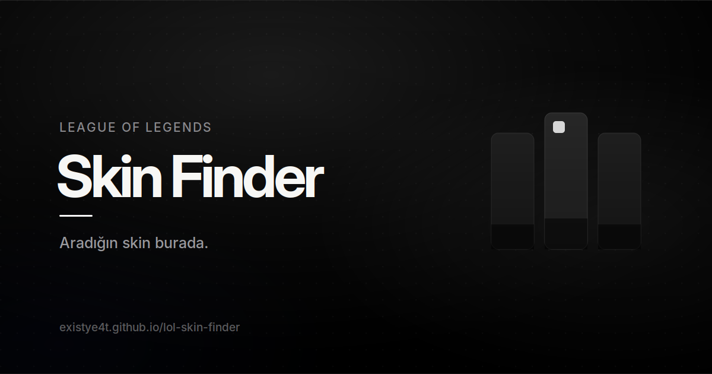
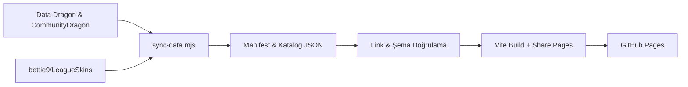

<div align="center">

<a href="https://existye4t.github.io/lol-skin-finder/">
  
</a>

<br />

<h1>LoL Skin Finder</h1>

<p>
  <strong>League of Legends skinlerini, chromalarını, PBE, Rainbow ve Classic koleksiyonlarını tek yerde keşfet — doğrudan <code>.fantome</code> veya şampiyon paketi (<code>.zip</code>) olarak indir.</strong>
</p>

<p>
  <a href="https://existye4t.github.io/lol-skin-finder/">
    
  </a>
  <a href="https://github.com/existye4t/lol-skin-finder/actions/workflows/deploy-pages.yml">
    
  </a>
  <a href="https://github.com/existye4t/lol-skin-finder/actions/workflows/sync-skins.yml">
    
  </a>
  <a href="https://discord.gg/rvRxbf8B9N">
    
  </a>
  
</p>

<p>
  <a href="#-özellikler">Özellikler</a> ·
  <a href="#-koleksiyonlar-ve-veri-kaynağı">Koleksiyonlar</a> ·
  <a href="#-yerel-kurulum-ve-komutlar">Kurulum</a> ·
  <a href="#-veri-senkronizasyonu">Senkronizasyon</a> ·
  <a href="#-ekosistem-ve-proje-yapısı">Proje Yapısı</a> ·
  <a href="#-klavye-kısayolları">Kısayollar</a>
</p>

</div>

---

## ✨ Özellikler

Framework yükü olmadan **Vanilla JavaScript + Vite** mimarisiyle hız ve akıcılık odağında geliştirilmiştir.

| Kategori | Neler Sunar? |
| :--- | :--- |
| **Anlık & Akıllı Arama** | Skin adı, şampiyon adı veya Riot Skin ID ile anında arama; Türkçe karakter ve aksan farklılıklarını otomatik yok sayar. |
| **Hızlı Arama Paleti** | `Ctrl + K` / `Cmd + K` ile açılan puanlamalı arama paleti; tamamen klavyeyle gezilebilir. |
| **`.fantome` & Şampiyon Paketi** | Tekil skin/chroma `.fantome` dosyalarını doğrudan indirme veya seçili şampiyonun tüm skinlerini (isteğe bağlı chromalarla) tarayıcıda tek bir `.zip` paketi hâlinde indirme (`client-zip`). |
| **Chroma & Form Desteği** | Tüm chroma seçeneklerini, özel form/varyant paketlerini ve detay görsellerini tek pencerede görüntüleme. |
| **Özel Paylaşım Kartları** | Her skin için dile özel (`TR`/`EN`) paylaşım bağlantıları ve zengin önizleme (Open Graph / Discord) kartları. |
| **Favoriler & Filtreleme** | Çoklu şampiyon filtreleme ve tarayıcıda kalıcı favori skin listesi. |
| **3 Görünüm & Shader Efekti** | **Siyah-Beyaz**, **Hextech Altın** ve **Arcane Neon** temaları + `@paper-design/shaders` akışkan arka planı. |
| **Çift Dil (TR / EN)** | Arayüz metinleri, şampiyon adları ve skin isimleri arasında anında dil geçişi. |
| **Erişilebilir & Responsive** | Masaüstü/mobil uyumlu tasarım, ARIA etiketleri, klavye desteği ve `prefers-reduced-motion` uyumluluğu. |

---

## 🧩 Koleksiyonlar ve Veri Kaynağı

Katalog verileri ve `.fantome` indirme bağlantıları iki ana kaynaktan **günde 4 kez otomatik** senkronize edilir:

1. **Riot Games Data Dragon & CommunityDragon** — Canlı sunucu (Live) ve PBE skin/chroma meta verileri, Türkçe ve İngilizce yerelleştirmeler.
2. **[bettie9/LeagueSkins](https://github.com/bettie9/LeagueSkins)** — Live, PBE, Rainbow ve Classic `.fantome` paketleri commit’e sabitlenmiş bağlantılarla bu depodan indirilir.

| Koleksiyon | Kaynak Dizini | Açıklama |
| :--- | :--- | :--- |
| **Skinler (Live + PBE)** | `skins/` + `PBE/` | Canlı sunucudaki tüm skinler, chromalar, form/varyant paketleri ve `PBE` rozetli önizlemeler aynı sekmede listelenir. Bir PBE skini canlıya geçtiğinde rozet otomatik kalkar. |
| **Rainbow** | `rainbow/` | Oyun içinde `Ctrl + 5` ile chroma değiştirmeyi sağlayan Rainbow paketleri. Rainbow sekmesinden veya desteklenen skinlerin detayındaki `Rainbow sürümü →` bağlantısından erişilir. |
| **Classic** | `classic/` | League Classic modu için hazırlanmış özel şampiyon skin ve chroma paketleri (Classic sekmesinde aranır). |

> [!WARNING]
> * Kaynak repodaki paketler otomatik olarak üretilir ve tek tek test edilmez; bazı skinlerde veya formlarda oyun içi görsel/ses sorunları oluşabilir.
> * **PBE** etiketli içerikler önizleme sürümüdür; canlı sunucuya çıkmadan önce değişebilir veya kararsız çalışabilir.

---

## ⚙️ Veri Senkronizasyonu



GitHub Actions (`sync-skins.yml`), her gün **00:17, 06:17, 12:17 ve 18:17 UTC** saatlerinde çalışarak kataloğu güncel tutar, doğrular ve değişiklik varsa tek commit ile `main` dalına yazarak Pages dağıtımını tetikler.

<details>
<summary><strong>Teknik detaylar: Manifest üretimi, doğrulama ve manuel komutlar</strong></summary>

<br />

Senkronizasyon, kaynak reponun indekslerini ve Git ağacını aynı commit üzerinden okur. Paketler kategori, şampiyon, skin ve varyant kimliğiyle eşlenir. Taşınan dosyalar için aynı şampiyon altında tek eşleşmesi bulunan önceki Git blob'u yeniden kullanılabilir; eksik veya belirsiz bağlantılar katalogda devre dışı bırakılır.

Rainbow indeksindeki boyut Git blob'undan farklıysa paket içindeki `META/build.json` dosyası şampiyon ve skin numarasıyla karşılaştırılır ve doğrulanmış sonuçlar aynı blob için yeniden kullanılır.

**Tek adımda senkronizasyon ve test:**
```bash
npm run sync-data                      # Tam senkronizasyon + doğrulama
npm run sync-data -- --dry-run         # Dosya yazmadan doğrulama
npm run sync-data -- --download-samples # Örneklem paket indirme testi
npm run test:sync                      # Katalog senkronizasyon birim testleri
```

**Adım adım çalıştırma:**
```bash
npm run prepare-fantome   # Git Trees API + indekslerle fantome-manifest.json üret
npm run update-data       # Data Dragon + CommunityDragon + manifest ile JSON katalogları üret
npm run check-links       # Şema, varlık kontrolü, URL encode ve HEAD doğrulaması
npm run verify-collections # Koleksiyon tutarlılık kontrolü
```

**Manuel Actions Tetikleme (`workflow_dispatch`):**
* `dry_run`: Yalnızca doğrulama ve derleme çalıştırır, yayınlamaz.
* `force_deploy`: Veri değişmese dahi doğrulanmış koşuda Pages dağıtımını yeniler.

Kaynak dalı varsayılan olarak `main`’dir. Yerelde `SKIN_SOURCE_BRANCH` ile farklı bir kaynak dalı veya `SKIN_SOURCE_SHA` ile doğrulanacak tam commit seçilebilir. Eski sağlayıcıya özgü ortam değişkenleri ve yerel paket geri dönüşü kaldırıldı.

</details>

<details>
<summary><strong>🛑 Geri Alma (Rollback) Prosedürü</strong></summary>

<br />

1. **Doğrulanmış kataloğu geri yükleme:**
   Bilinen son geçerli LeagueSkins manifestini ve üç katalog dosyasını aynı commit’ten geri yükleyip normal PR ve Pages akışından geçirin.

2. **Otomatik Senkronizasyonu Durdurma:**
   GitHub üzerinden **Actions → Kaynak Repodan Skin Senkronizasyonu → `...` → Disable workflow** adımıyla zamanlanmış koşuları durdurabilirsiniz.

</details>

---

## 🚀 Yerel Kurulum ve Komutlar

**Gereksinimler:** Node.js `20+` ve `npm`

```bash
# 1. Repoyu klonla
git clone https://github.com/existye4t/lol-skin-finder.git
cd lol-skin-finder

# 2. Bağımlılıkları kur
npm install

# 3. Geliştirme sunucusunu başlat
npm run dev
```

| Komut | Açıklama |
| :--- | :--- |
| `npm run dev` | Vite geliştirme sunucusunu (`127.0.0.1`) başlatır. |
| `npm run build` | Production build alır ve statik çıktıları hazırlar. |
| `npm run preview` | Alınan production build'i yerelde önizler. |
| `npm test` | Uygulamayı derler ve Playwright E2E test paketini çalıştırır. |
| `npm run sync-data` | Katalog, manifest ve bağlantı doğrulama hattını çalıştırır. |
| `npm run generate-share-art` | Paylaşım sayfaları için görsel/kart üretimini çalıştırır. |
| `npm run admin-server` | Yerel yönetim arayüzü geliştirme sunucusunu başlatır. |

---

## 📦 Ekosistem ve Proje Yapısı

```text
lol-skin-finder/
├── src/                # Ana uygulama (main.js, style.css, skin-share.js)
├── public/             # Katalog JSON'ları, statik görseller ve önizleme varlıkları
├── scripts/            # Senkronizasyon, manifest, doğrulama ve paylaşım kartı araçları
├── tests/              # Playwright E2E ve Node senkronizasyon testleri
├── admin/              # Yönetim paneli arayüzü
├── backend/            # Cloudflare Workers tabanlı güvenli GitHub API köprüsü
├── bot/                # Topluluk Discord botu (detaylar için bot/README.md)
└── .github/workflows/  # Otomatik senkronizasyon ve GitHub Pages dağıtım akışları
```

### Teknoloji Yığını


---

## ⌨️ Klavye Kısayolları

| Kısayol | İşlev |
| :--- | :--- |
| `Ctrl + K` / `Cmd + K` | Hızlı arama paletini aç |
| `↑` / `↓` & `Enter` | Arama sonuçları arasında gezin ve seç |
| `Esc` | Açık pencereyi veya arama paletini kapat |

---

## 🎨 Görünüm Temaları

Seçilen tema tarayıcıda (`localStorage`) saklanır ve sonraki ziyaretlerde korunur:

* **Siyah-Beyaz** — Minimalist yüksek kontrastlı karanlık tema
* **Hextech Altın** — Klasik League of Legends estetiği
* **Arcane Neon** — Canlı neon vurgulu görünüm

---

## 🤝 Katkıda Bulunma ve Topluluk

Hata bildirmek, yeni özellik önermek veya doğrudan koda katkıda bulunmak için [Issue](https://github.com/existye4t/lol-skin-finder/issues) ya da [Pull Request](https://github.com/existye4t/lol-skin-finder/pulls) açabilir; güncellemeler ve destek için Discord sunucumuza katılabilirsin:

👉 **[Discord Topluluğuna Katıl](https://discord.gg/rvRxbf8B9N)**

### Teşekkürler
Kaynak paket altyapısı, veri kaynakları ve araçları için **[bettie9/LeagueSkins](https://github.com/bettie9/LeagueSkins)**, **[bettie9/Sunshine](https://github.com/bettie9/Sunshine)** ve **[CommunityDragon](https://www.communitydragon.org/)** projelerine teşekkürler.

---

## 🔒 Gizlilik ve ⚖️ Yasal Uyarı

* **Gizlilik:** Temel skin arama, favori ve indirme özellikleri kullanıcı hesabı gerektirmez. Google Analytics etkinleştirildiğinde yalnızca anonim ve toplu kullanım/arama/indirme istatistikleri ölçülür; kişisel hesap veya kimlik bilgisi tutulmaz.
* **Yasal Uyarı:** *League of Legends* ve ilgili tüm oyun, şampiyon, skin ve görsel varlıklar **Riot Games, Inc.** mülkiyetindedir. Bu proje Riot Games tarafından geliştirilmemiş, onaylanmamış veya resmi olarak desteklenmemiş bağımsız ve açık kaynaklı bir topluluk projesidir.

<div align="center">
  <br />
  <sub><strong>Exist LoL Skin Finder</strong> · League of Legends skinlerini keşfetmenin en hızlı yolu.</sub>
</div>
